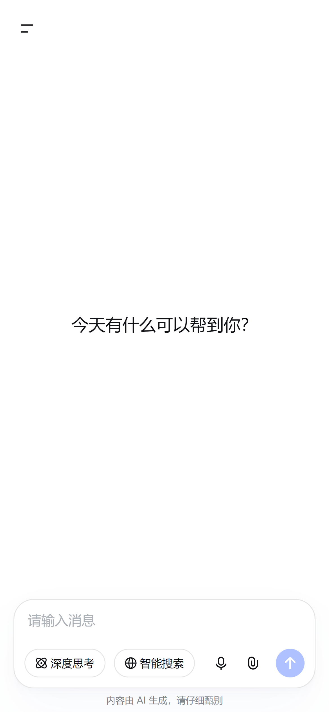
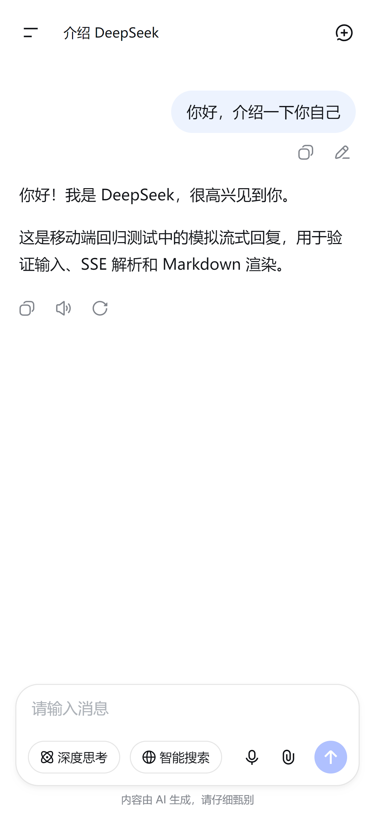
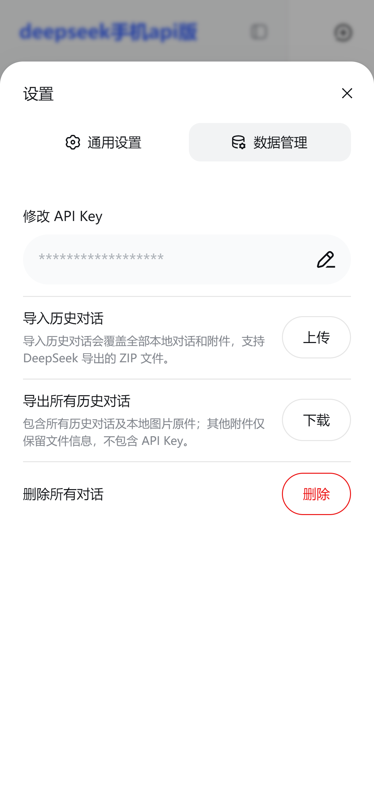
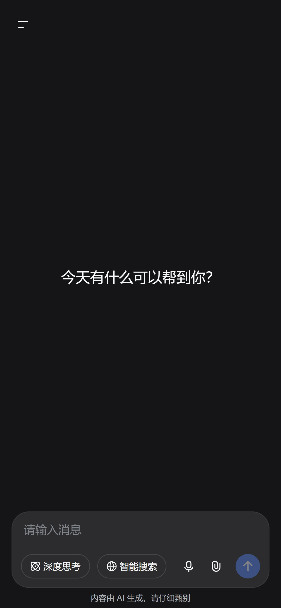

# deepseek手机api版（非官方）


基于 [DeepSeek 官方开源的 chat-demo](https://github.com/deepseek-ai/chat-demo) 二次开发的移动端聊天应用。界面与交互尽量保持官方网页版体验，聊天请求由 WebView/PWA 直接连接 `https://api.deepseek.com`，不需要自建业务后端。

交付两种形态：

- **Android APK**：Capacitor 原生壳，包含自定义图标与启动图、安全区适配、系统返回键、原生分享等能力。
- **PWA**：同一份 `dist/` 静态站点，可部署到 HTTPS 后“添加到主屏幕”，覆盖 iPhone 与桌面浏览器。

> 本项目不是 DeepSeek 官方发布的客户端，不代表官方立场。应用名称中的“DeepSeek”仅用于说明所接入的服务与界面来源。上游代码采用 MIT 许可证，详见 [LICENSE](LICENSE) 与 [上游说明](docs/upstream-README.zh-CN.md)。

## 本次更新（1.1.2）

- 支持从 GitHub Pages 远程热更新前端：应用启动后自动检查 `version.json`，下载并校验更新包，重启生效；网络异常时回退到 APK 内置资源。
- 可切换 `deepseek-flash` / `deepseek-v4-pro` 模型，调节思考强度（低 / 高 / 极高）。
- 每条回复显示实际使用的模型、Token 用量与缓存命中率，点按可展开明细。
- 版本号 `1.1.2`（versionCode 4），包名仍为 `com.dsmobile.chat`。

### 如何发布前端更新

1. 修改前端代码后提升 `package.json` 的 `version`。
2. `git commit && git push origin main`，GitHub Actions 会自动构建并部署到 GitHub Pages。
3. 已安装 1.1.2 及更高版本 APK 的用户启动应用后会自动下载更新，提示重启后生效。

仅前端代码可热更新；涉及原生能力（权限、插件）的改动仍需发新 APK。

## 功能

- 多会话、自动标题、重命名/删除、编辑提问、重新生成、消息分支切换。
- 流式回复、深度思考、智能搜索、链接阅读与引用来源；可停止生成、续写。
- 附件上传/粘贴/拖拽，语音输入与朗读；移动端录音时显示实时频谱。
- Markdown、代码高亮、KaTeX 公式、Mermaid 图表。
- 简体中文/英文、浅色/深色主题、历史记录 ZIP 导入导出。
- 移动端专项：状态栏与手势区安全区、底部弹层设置、抽屉侧栏、键盘避让、Android 返回键分层关闭、原生文件分享、启动图与自适应图标。
- PWA：应用壳离线缓存，断网时仍能打开界面；聊天与语音仍需网络。

| 欢迎 | 聊天 | 设置 | 深色 |
| --- | --- | --- | --- |
|  |  |  |  |

## 安装 APK

文件：[`release/deepseek-mobile-api-1.1.0-debug.apk`](release/deepseek-mobile-api-1.1.0-debug.apk)（[安装说明](release/安装说明.txt) · [SHA-256](release/SHA256SUMS.txt)）

| 项目 | 值 |
| --- | --- |
| 应用名称 | `deepseek手机api版` |
| 包名 | `com.dsmobile.chat` |
| 版本 | `1.1.0`（versionCode 2） |
| 最低系统 | Android 7.0（API 24） |
| 目标 API | 36 |
| 大小 | 13,255,280 字节 |
| SHA-256 | `67D26F606C95FDDB9C92E98EC7725B47A8D5F58F51C9E472A9722BCBD974EC3E` |

安装步骤：

1. 将 APK 传到 Android 手机（数据线、网盘或聊天工具均可）。
2. 在系统设置中允许对应文件管理器/浏览器“安装未知应用”。
3. 打开 APK 完成安装，桌面会出现“deepseek手机api版”与鲸鱼女仆图标。
4. 首次启动后进入 **设置 → 数据管理 → API Key**，粘贴在 [DeepSeek 开放平台](https://platform.deepseek.com/api_keys) 创建的 Key。
5. 返回首页开始对话。

> 这是使用 Android Debug 证书签名的调试包，适合自用与验收，不适合直接上架应用商店。正式发布前请替换为自己的 release keystore。

## 使用 PWA

`pnpm build` 生成的 `dist/` 是完整静态站点，包含 `manifest.webmanifest`、`sw.js`、图标和许可证。部署要求：

- 必须通过 **HTTPS** 访问（`localhost` 例外），否则 Service Worker 不会注册。
- 部署在域名根路径或子路径均可；`start_url`、`scope` 使用相对路径 `./`。
- 不要把 `index.html` 直接以 `file://` 打开用于 PWA 安装；`file://` 下离线缓存不可用。

本地预览：

```sh
pnpm build
python -m http.server 8080 -d dist
# 打开 http://localhost:8080
```

实测 DeepSeek API 会对请求的 `Origin` 回显 `access-control-allow-origin`（包括 `https://example.com`），因此静态站点可直接访问；如果官方后续收紧 CORS，PWA 部署就需要自建同源代理。

iPhone：Safari 打开站点 → 分享 → “添加到主屏幕”。Android Chrome 同样支持“安装应用”。离线时只能打开应用壳，发送消息仍需网络。

## 从源码运行

要求：

- Node.js 22.12+（本项目在 Node 24.15 上验证）
- pnpm 9+
- Android 构建额外需要 JDK 21、Android SDK Platform 36、Build-Tools 36.0.0

```sh
pnpm install
pnpm dev          # http://localhost:8090
pnpm type         # TypeScript 类型检查
pnpm lint         # oxlint
pnpm build        # 生成 dist/
```

### 构建 APK

本机已验证的路径：

```powershell
$env:JAVA_HOME = 'D:\Android\jdk21\jdk-21.0.2'
$env:ANDROID_HOME = 'D:\Android\sdk'
$env:ANDROID_SDK_ROOT = 'D:\Android\sdk'
$env:Path = "$env:JAVA_HOME\bin;$env:ANDROID_HOME\platform-tools;$env:Path"

pnpm android:apk
```

产物：`android/app/build/outputs/apk/debug/app-debug.apk`。

脚本 `scripts/android-build.mjs` 会依次执行：

1. `pnpm build`（Rspack 生产构建，复制 `public/` 到 `dist/`）
2. `pnpm exec cap sync android`
3. `android/gradlew.bat assembleDebug`

如首次构建缺少 SDK 组件，可用 `sdkmanager` 安装：

```sh
sdkmanager "platform-tools" "platforms;android-36" "build-tools;36.0.0"
sdkmanager --licenses
```

### 图标与启动图

- 原图：`assets/character.jpg`（用户提供的蓝发鲸鱼女仆插画）。
- 生成脚本：`scripts/make-icon-assets.py`，使用 Pillow/numpy 去背景并合成 1024 图标、自适应前景/背景、PWA 图标、favicon 与 2732 启动图。
- Android 资源：执行 `pnpm android:assets`。该命令调用 `@capacitor/assets` 生成各密度/横竖屏/夜间资源，然后由 `scripts/patch-adaptive-icon.mjs` 把自适应背景改为 full-bleed，避免生成器默认的 16.7% 背景内缩。
- 启动图标题精确为 `deepseek手机api版`，副标题 `DEEPSEEK MOBILE API`。

### Android 构建注意事项

- **项目路径不要含中文**。当前工程位于 `D:\ds手机版`，AGP 会报 `Your project path contains non-ASCII characters`；已在 `android/gradle.properties` 设置 `android.overridePathCheck=true` 绕过（实验选项）。更稳妥的做法是把工程移到纯 ASCII 路径。
- Gradle Wrapper 使用华为云镜像（`android/gradle/wrapper/gradle-wrapper.properties`），以适配国内网络；海外网络可改回 `services.gradle.org`。
- 正式签名：在 `android/app/build.gradle` 增加 `signingConfigs.release`，不要把 keystore 和密码提交到仓库。
- `android:allowBackup="false"`，避免系统备份带走 WebView 中的 API Key。

## 测试与验收

```sh
pnpm type
pnpm lint
pnpm test:e2e
pnpm test:pwa
```

已执行的验证（2026-11-22，1.1.0）：

| 项目 | 结果 |
| --- | --- |
| TypeScript 类型检查 | 通过 |
| oxlint | 通过，0 warnings / 0 errors |
| Playwright 移动端回归（390×844，3x） | 通过 |
| PWA 离线回归 | 通过，首次安装缓存 9 项资源 |
| Android Debug APK 构建 | `BUILD SUCCESSFUL`，244 tasks |
| APK 元数据 | `com.dsmobile.chat`，versionName 1.1.0 / versionCode 2，minSdk 24，targetSdk 36 |
| APK 标签 | `deepseek手机api版` |
| APK 签名 | v2 验证通过（Android Debug 证书） |
| APK 对齐 | `zipalign -c -v 4` 通过 |

E2E 覆盖：标题/manifest、欢迎语、安全区注入后顶栏位置、发送请求体、SSE 流式回复、会话标题、设置底部弹层、API Key 标签、深色主题持久化、无横向溢出、无 console error。截图见 [`tests/screenshots/`](tests/screenshots/)。

> 当前环境没有 Android 真机或模拟器（`adb devices` 为空），因此 APK 只完成了构建、元数据、签名与对齐的静态校验，未做真机安装运行。真机首次安装后请重点检查：状态栏/手势区、软键盘顶起输入框、录音权限、系统分享导出。

## 数据与隐私

- API Key 保存在 WebView 的 `localStorage`（键 `chat-demo:api-key`），会话与附件原图保存在 IndexedDB。
- 没有自建业务后端；聊天、附件、语音等请求直接发往 `https://api.deepseek.com`。
- 导出 ZIP 不包含 API Key；导入会覆盖本机全部会话与附件，操作前会二次确认。
- 卸载应用或清除应用数据会删除本地会话与 Key；请先在设置中导出备份。
- 语音识别会把录音发送到配置的 API 服务；智能搜索/链接阅读会把相关查询与 URL 发送到服务端。请勿在不可信网络下使用敏感内容。
- 本项目不会把 Key 写入日志、崩溃上报或第三方统计；但 Debug 包仍建议只自行安装使用。

## 项目结构

```text
src/
  app/                 应用布局、主题、全局样式、视口处理
  components/          聊天、设置、Markdown、搜索等 UI
  i18n/                中英文文案
  services/
    api/               Messages / Files API、SSE 解析
    chat/              会话、分支、存储、导入导出
    markdown/          Markdown、高亮、图表
    speech/            录音与朗读
  services/native.ts   Capacitor 原生壳桥接（状态栏/返回键/启动图/分享）
  services/pwa.ts      Service Worker 注册
public/                manifest、sw.js、PWA 图标、favicon
assets/                角色原图、透明角色、图标/启动图生成结果
android/               Capacitor Android 工程
scripts/               构建、APK 打包、图标生成、adaptive icon 修正
tests/                 Playwright E2E、PWA 离线测试、截图
docs/                  上游 README 存档
```

## 已知限制

- Android 包为 Debug 签名；未提供 release keystore、AAB 或上架配置。
- 未打包 iOS 原生工程；iPhone 通过 PWA 使用。
- PWA 离线仅缓存应用壳，聊天、附件、语音必须联网。
- 语音、搜索、标题等能力依赖官方 API 的服务端扩展；若官方接口调整，需要同步升级上游代码。
- 默认模型为 `deepseek-flash`；模型列表与额度以 DeepSeek 开放平台为准，使用会产生费用。
- Windows 中文路径依赖 `android.overridePathCheck=true`；这是 AGP 的实验开关，建议迁移到 ASCII 路径。

## 二次开发说明

相对上游 `chat-demo` 的主要改动：

- 品牌化：应用名、角色图标、启动图、PWA manifest、favicon、页面标题与描述。
- 移动端：安全区变量、顶栏/底栏/抽屉/搜索面板/设置弹层适配、Android 返回键、启动图隐藏、状态栏明暗同步。
- 原生能力：Capacitor Android 工程、文件导出走 `Filesystem + Share`、录音权限。
- 工程化：跨平台构建脚本、APK 打包脚本、图标生成脚本、Playwright E2E 与 PWA 离线回归、README/验收记录。
- 修复：已保存 API Key 时的输入标签、最上层 Modal 的返回键关闭、PWA 首次安装后的离线缓存。

上游英文/中文 README 存档在 [`docs/upstream-README.md`](docs/upstream-README.md) 与 [`docs/upstream-README.zh-CN.md`](docs/upstream-README.zh-CN.md)。

## License

[MIT](LICENSE)。分发时请保留 `LICENSE` 与上游版权声明；第三方依赖遵循各自许可证。
